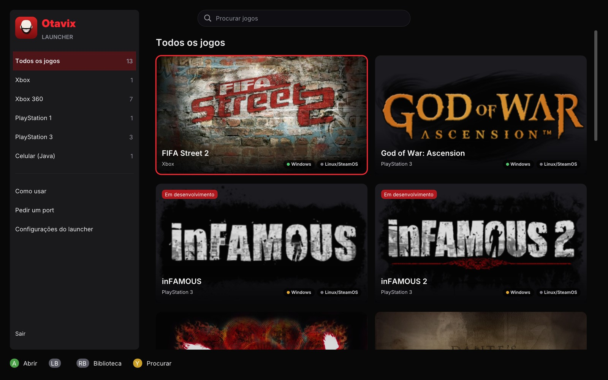
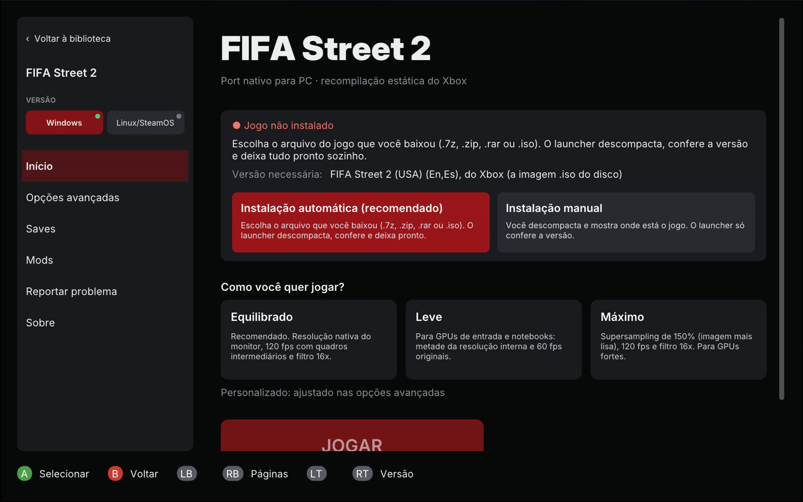
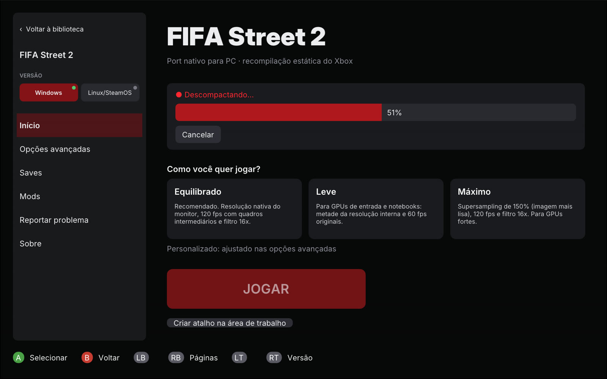
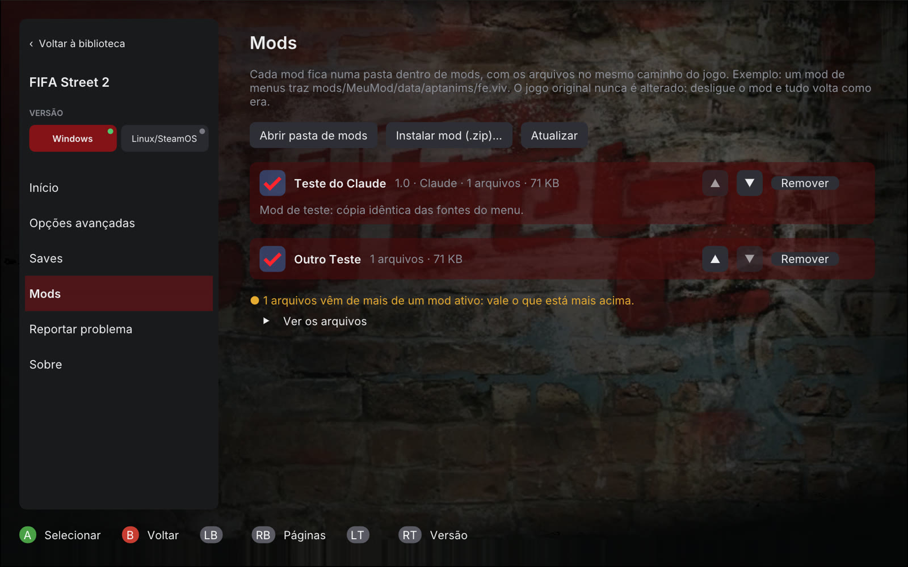
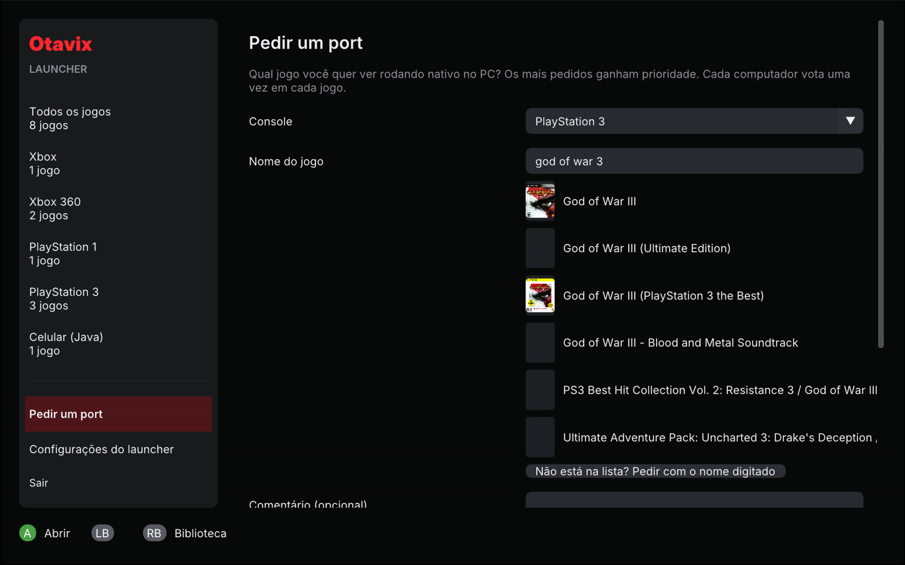
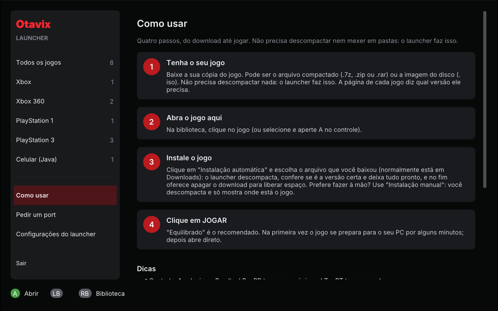
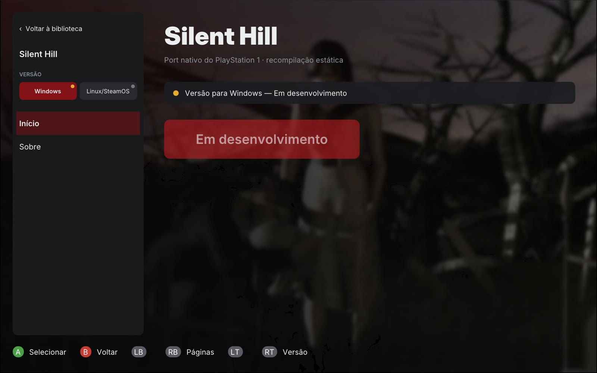

# Otavix Launcher

Um lugar só para jogar os **ports nativos para PC** de jogos de console feitos pelo Otavix: escolha o jogo, o launcher
baixa o port, instala o seu jogo a partir do arquivo que você baixou, confere a versão e deixa tudo pronto. Funciona com
mouse, teclado e controle.

> **Nenhum jogo acompanha o launcher.** Você usa a sua própria cópia de cada jogo. Os ports trazem só os arquivos do PC;
> o código do jogo é preparado no seu computador, a partir da sua cópia, na primeira vez que ele abre.

## Baixar

| Sistema | Arquivo |
|---|---|
| **Windows 10 e 11, 64 bits** | [Instalar-Otavix-Launcher.exe](https://github.com/otavix010/otavix-launcher/releases/latest/download/Instalar-Otavix-Launcher.exe) |
| **Linux / SteamOS (Steam Deck, Legion Go S)** | [Otavix-Launcher-linux-x64.tar.gz](https://github.com/otavix010/otavix-launcher/releases/latest/download/Otavix-Launcher-linux-x64.tar.gz) |

Os dois links levam sempre à última versão. Todas as versões ficam em [Releases](https://github.com/otavix010/otavix-launcher/releases/latest).

### Instalar no Windows

1. Baixe o `Instalar-Otavix-Launcher-<versão>.exe`.
2. Abra e siga o instalador. Não precisa de administrador: ele instala na sua pasta de usuário.
3. Abra o Otavix Launcher, escolha um jogo e siga a página dele: **Baixar o port** e depois **Instalar o jogo**.

### Instalar no Linux / SteamOS

1. Baixe o `Otavix-Launcher-<versão>-linux-x64.tar.gz` e extraia numa pasta sua (por exemplo, em `~/Games`).
2. Execute `./instalar.sh` dentro da pasta para criar a entrada no menu (modo desktop). No Modo Jogo do SteamOS, adicione `Otavix Launcher` como jogo fora da Steam.
3. Abra o Otavix Launcher, escolha um jogo e siga a página dele. Na versão Linux estão disponíveis o **God of War: Betrayal**, o **God of War: Ascension**, gerado no seu PC pelo launcher (precisa de um Proton instalado na Steam e de uns 15 GB livres), e o **inFAMOUS Second Son**. Os outros jogos ficam como "em breve".

> **Baixe só daqui.** O launcher e os ports oficiais saem só desta página e do próprio launcher, que se atualiza sozinho.
> Cópias repostadas em outros sites (Mediafire, pacotes "P2P" ou "repack") não são nossas e podem estar velhas ou alteradas.

A página **Como usar**, dentro do launcher, explica tudo passo a passo.

## O que ele faz

| | |
|---|---|
| **Biblioteca** | Os jogos separados por console, com a arte e a música tema de cada um (tiradas da sua cópia do jogo). |
| **Ports sempre atualizados** | Baixa o port de cada jogo do GitHub e avisa quando sai uma versão nova. O pacote baixado é conferido pelo SHA-256 publicado. |
| **Instalação automática** | Escolha o arquivo baixado (`.7z`, `.zip`, `.rar` ou `.iso`): o launcher descompacta, confere se é a versão certa para o port e guarda no lugar certo. |
| **Instalação manual** | Para quem prefere descompactar à mão: é só mostrar a `.iso` ou a pasta, e o launcher confere a versão. |
| **Opções do jogo** | Predefinições simples (Equilibrado, Leve, Máximo) e opções avançadas: resolução, tamanho da janela, limite de fps, anti-aliasing DLSS/FSR/XeSS, filtro, som, controles. |
| **Saves** | Cópia de segurança automática antes de cada partida e restauração com um clique. |
| **Mods** | Instala mods de `.zip`, liga, desliga e ordena; avisa quando dois mods trocam o mesmo arquivo. O jogo original nunca é alterado. |
| **Versões** | Cada jogo mostra a versão Windows e a Linux/SteamOS e o estado de cada uma. |
| **Atalhos** | Cria um atalho na área de trabalho que abre direto no jogo. |
| **Reportar problema** | Junta as informações técnicas (sistema, placa de vídeo, log) e mostra tudo antes de enviar. |
| **Pedir um port** | Busca no catálogo de cada console, com a capa, e mostra os mais pedidos da semana, do mês e de sempre. |
| **Idiomas** | Português do Brasil, inglês e espanhol. |

| Instalar o jogo | Instalando |
|---|---|
|  |  |

| Mods | Pedir um port |
|---|---|
|  |  |

| Como usar | Jogo em desenvolvimento |
|---|---|
|  |  |

## Jogos

| Jogo | Console | Windows | Linux/SteamOS |
|---|---|---|---|
| [God of War: Ascension](https://github.com/otavix010/gow-ascension-pc) | PlayStation 3 | jogável (gerado no seu PC) | jogável (gerado no seu PC) |
| inFAMOUS Second Son | PlayStation 4 | jogável | jogável |
| [God of War](https://github.com/otavix010/god-of-war-pc), [God of War II](https://github.com/otavix010/god-of-war-2-pc) | PlayStation 2 | beta (gerado no seu PC, com save state) | em breve |
| [Spawn: Armageddon](https://github.com/otavix010/spawn-armageddon-pc) | PlayStation 2 | beta (gerado no seu PC, com save state) | em breve |
| [Blade II](https://github.com/otavix010/blade-2-pc), Tekken 5, [Castlevania: Lament of Innocence](https://github.com/otavix010/castlevania-lament-of-innocence-pc), [Castlevania: Curse of Darkness](https://github.com/otavix010/castlevania-curse-of-darkness-pc), Ghost Rider, Medal of Honor: European Assault, 10.000 Bullets | PlayStation 2 | beta (gerado no seu PC) | em breve |
| God of War: Chains of Olympus, God of War: Ghost of Sparta | PSP | beta (gerado no seu PC, com save state) | em breve |
| [Asura's Wrath](https://github.com/otavix010/asuras-wrath-pc), [Dante's Inferno](https://github.com/otavix010/dantes-inferno-pc), [DiRT 2](https://github.com/otavix010/dirt-2-pc), [Saints Row](https://github.com/otavix010/saints-row-pc) | Xbox 360 | jogável (gerado no seu PC) | em breve |
| [FIFA Street 2](https://github.com/otavix010/fifa-street-2-pc) | Xbox | jogável | em breve |
| [God of War: Betrayal](https://github.com/otavix010/gow-betrayal-pc) | Celular (Java) | jogável | jogável |
| [Silent Hill](https://github.com/otavix010/silent-hill-pc) | PlayStation 1 | jogável | em breve |
| inFAMOUS, inFAMOUS 2, Army of Two (os três), outros de PS2 | vários | em desenvolvimento | em breve |

A lista completa e atualizada, com o estado de cada versão, fica dentro do launcher.

O God of War: Ascension é gerado no seu PC: o launcher baixa o código do port, confere as ferramentas (Python e Visual
Studio Build Tools, com botões que instalam), pede o disco, o update 1.04 e o firmware do PS3 e traduz e compila o jogo
uma vez (de 4 a 20 minutos). Nada do jogo vem com o launcher nem com o port.

Os ports de Xbox 360 seguem o mesmo modelo: o launcher pede a `.iso` do jogo, o gerador do port baixa as ferramentas
(o SDK da ReXGlue e um Clang portátil, uns 330 MB, uma vez para todos), traduz o código do jogo e compila. O jogo lê a
`.iso` direto. As opções seguem as do FIFA: resolução interna até 4K, FSR 1 ou CAS da AMD com nitidez, FXAA, filtro
anisotrópico, taxa de quadros real acima da do console (60, 120, 144) e contador de fps.

Capas e fundos vêm de bases públicas (a loja do Xbox 360, o GameTDB, as miniaturas do libretro) e ficam em cache; a
arte e a música tema da sua própria cópia, quando o port sabe ler, entram no lugar.

## Perguntas frequentes

**O gerador pede o Visual Studio Build Tools ou o Python.** Os jogos "gerados no seu PC" são compilados uma vez, no seu
computador, a partir da sua cópia. Na página **Gerar o jogo no seu PC**, clique em **Instalar** ao lado de cada
ferramenta; no Build Tools, deixe marcados "Desenvolvimento para desktop com C++" e o "SDK do Windows 11". Depois clique em
**Conferir de novo** (às vezes é preciso reiniciar o PC) e em **Gerar o jogo**.

**A geração parou num download.** Se o PC não abre https://github.com no navegador, algo bloqueia: filtro de DNS, VPN,
firewall, a proteção web do antivírus ou o DNS do roteador. Trocar o DNS da rede para 1.1.1.1 ou 8.8.8.8 costuma resolver.
Depois gere de novo: ele continua de onde parou.

**O Windows ou o antivírus bloqueou.** O jogo é um programa novo, compilado no seu PC. Com o **Controle Inteligente de
Aplicativos** ligado (Segurança do Windows > Controle de aplicativos e do navegador), nada que é gerado roda: desligue-o para
usar os ports gerados. Se for o antivírus, adicione uma exceção para a pasta do port.

**O gerador não aceitou a minha cópia.** Cada port é feito a partir de uma versão do disco; outra região, uma cópia "com
update" embutido, traduzida ou criptografada tem outro código. A mensagem do gerador diz qual é o caso e qual versão serve.
Nós não fornecemos jogos nem indicamos onde baixar.

**Algo deu errado.** Use **Reportar problema** na página do jogo: o report leva o log e os dados do PC, e a resposta
aparece no próprio launcher.

## Como é feito

O Otavix é um projeto de fãs, sem fins lucrativos, desenvolvido com a ajuda de assistentes de IA (Claude, da Anthropic),
que escrevem e testam boa parte do código sob a direção do autor. Cada versão passa por testes antes de ser publicada, e os
reports dos jogadores entram no mesmo ciclo.

## Para desenvolvedores

- **Compilar:** Visual Studio 2022 (ou Build Tools) com C++ e o componente Clang; depois `scripts\build.cmd`. O CMake baixa
  SDL 3, Dear ImGui e toml++.
- **Versão pública:** `scripts\release.cmd <versão>` gera o pacote, os catálogos (`scripts\catalogo.py`) e o instalador
  (Inno Setup 6); `scripts/pacote_linux.sh <versão>` gera o pacote Linux (compila no Legion). Na release do GitHub, além dos
  arquivos com versão, anexe as cópias de nome fixo `Instalar-Otavix-Launcher.exe` e `Otavix-Launcher-linux-x64.tar.gz`:
  são elas que os links "última versão" do README baixam.
- **Jogos e bibliotecas:** `hub\hub.toml` lista as bibliotecas e os ports; cada port tem um perfil em `profiles\` que
  descreve as páginas, as opções, os saves, a instalação e os mods.
- **Servidor** (reports e pedidos): `servidor\`, um Cloudflare Worker com banco D1; veja `servidor\LEIA-ME.md`.

## Licença

O **launcher** usa a [PolyForm Noncommercial 1.0.0](LICENSE): uso, estudo e modificação livres, mantendo os créditos;
**é proibido vender** ou usar comercialmente. Os **ports** têm licença própria, no repositório de cada um (MIT, cobrindo
só o código do port). Software de terceiros e créditos em [THIRD_PARTY.md](THIRD_PARTY.md).

---

**English.** Otavix Launcher is a hub for native PC ports of console games: pick a game, it downloads the port, installs
your own copy of the game from the file you downloaded (archive or disc image, release checked), and gets it ready to
play with mouse, keyboard or controller. Some ports are generated (compiled) once on your PC from your own copy. No game
is included, and we do not point to where to download games. Download the launcher only from this page or through the
launcher itself; reuploads on other sites are not ours. The launcher is licensed under PolyForm Noncommercial 1.0.0; each
port has its own license (MIT for the port's code).

**How it is made:** Otavix is a non-profit fan project developed with the help of AI assistants (Anthropic's Claude),
which write and test much of the code under the author's direction. Every release is tested before it is published, and
player reports feed the same loop.
