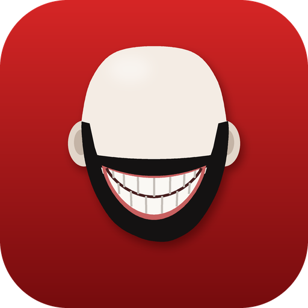
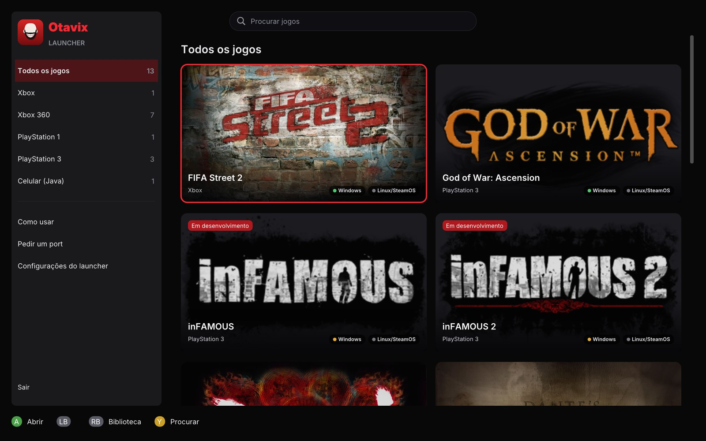
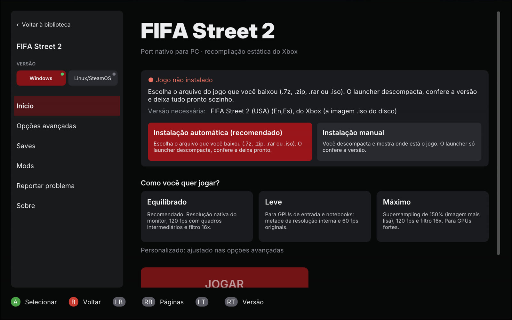
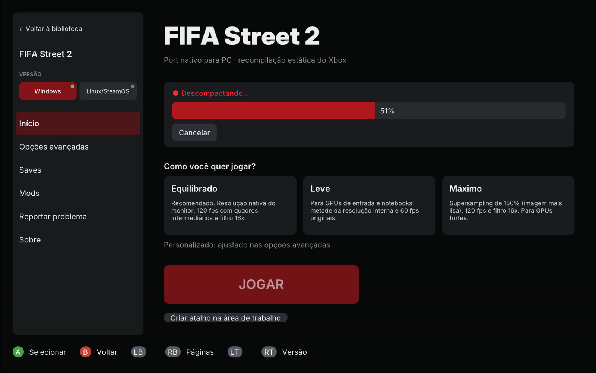
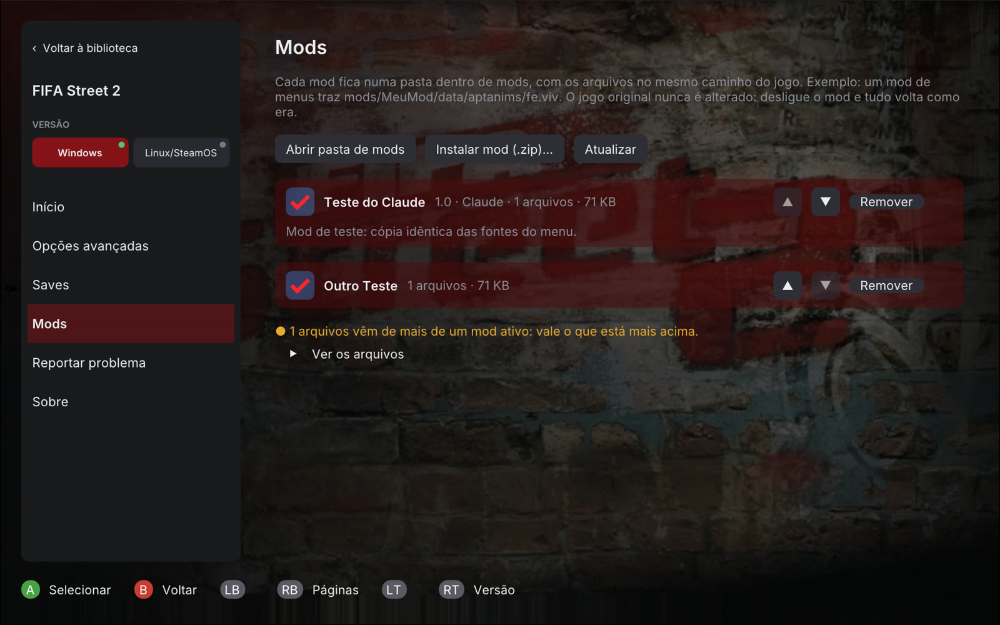
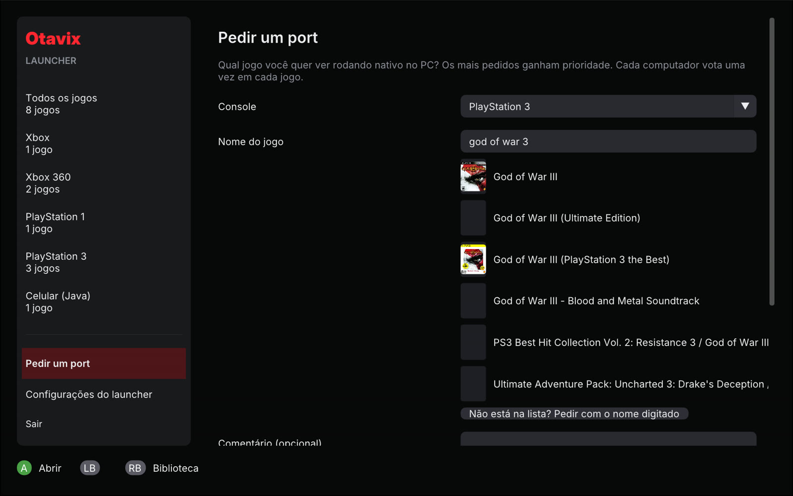
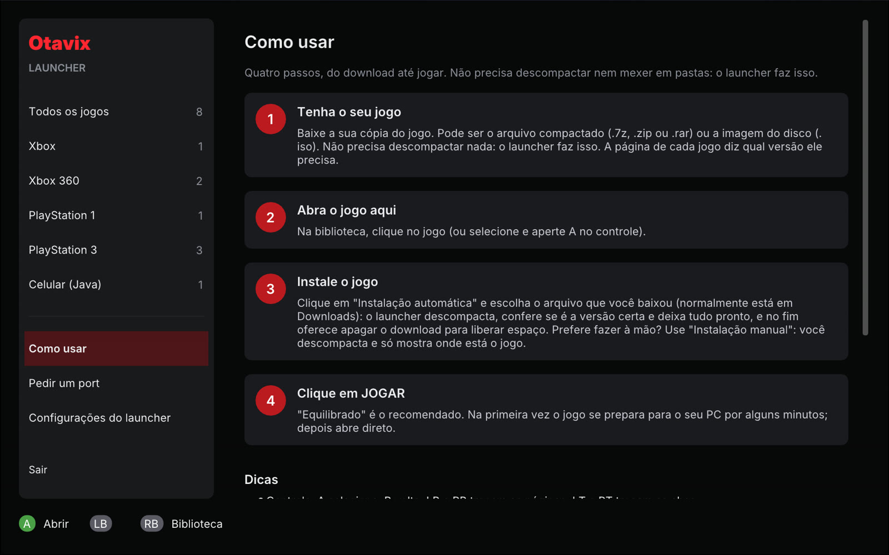
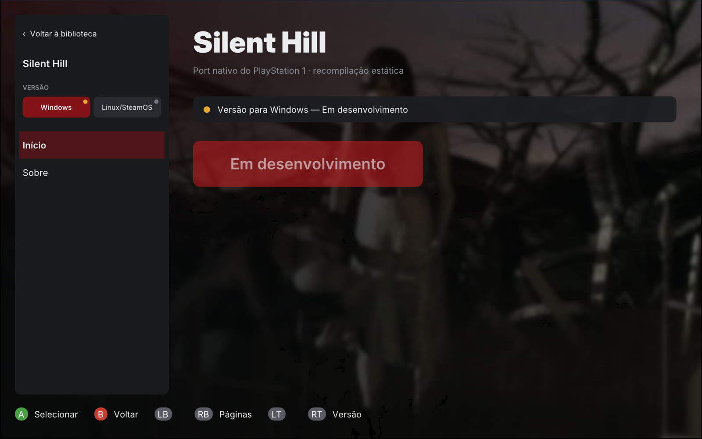

# Otavix Launcher

Um lugar só para jogar os **ports nativos para PC** de jogos de console feitos pelo Otavix: escolha o jogo, o launcher
baixa o port, instala o seu jogo a partir do arquivo que você baixou, confere a versão e deixa tudo pronto. Funciona com
mouse, teclado e controle.

> **Nenhum jogo acompanha o launcher.** Você usa a sua própria cópia de cada jogo. Os ports trazem só os arquivos do PC;
> o código do jogo é preparado no seu computador, a partir da sua cópia, na primeira vez que ele abre.

## Instalar (Windows 10 e 11, 64 bits)

1. Baixe o `Instalar-Otavix-Launcher-<versão>.exe` em [Releases](../../releases).
2. Abra e siga o instalador. Não precisa de administrador: ele instala na sua pasta de usuário.
3. Abra o Otavix Launcher, escolha um jogo e siga a página dele: **Baixar o port** e depois **Instalar o jogo**.

A página **Como usar**, dentro do launcher, explica tudo passo a passo.

## O que ele faz

| | |
|---|---|
| **Biblioteca** | Os jogos separados por console, com a arte e a música tema de cada um (tiradas da sua cópia do jogo). |
| **Ports sempre atualizados** | Baixa o port de cada jogo do GitHub e avisa quando sai uma versão nova. O pacote baixado é conferido pelo SHA-256 publicado. |
| **Instalação automática** | Escolha o arquivo baixado (`.7z`, `.zip`, `.rar` ou `.iso`): o launcher descompacta, confere se é a versão certa para o port e guarda no lugar certo. |
| **Instalação manual** | Para quem prefere descompactar à mão: é só mostrar a `.iso` ou a pasta, e o launcher confere a versão. |
| **Opções do jogo** | Predefinições simples (Equilibrado, Leve, Máximo) e opções avançadas: resolução, tamanho da janela, limite de fps, anti-aliasing DLSS/FSR/XeSS, filtro, som, controles. |
| **Saves** | Cópia de segurança automática antes de cada partida e restauração com um clique. |
| **Mods** | Instala mods de `.zip`, liga, desliga e ordena; avisa quando dois mods trocam o mesmo arquivo. O jogo original nunca é alterado. |
| **Versões** | Cada jogo mostra a versão Windows e a Linux/SteamOS e o estado de cada uma. |
| **Atalhos** | Cria um atalho na área de trabalho que abre direto no jogo. |
| **Reportar problema** | Junta as informações técnicas (sistema, placa de vídeo, log) e mostra tudo antes de enviar. |
| **Pedir um port** | Busca no catálogo de cada console, com a capa, e mostra os mais pedidos da semana, do mês e de sempre. |
| **Idiomas** | Português do Brasil, inglês e espanhol. |

| Instalar o jogo | Instalando |
|---|---|
|  |  |

| Mods | Pedir um port |
|---|---|
|  |  |

| Como usar | Jogo em desenvolvimento |
|---|---|
|  |  |

## Jogos

| Jogo | Console | Windows | Linux/SteamOS |
|---|---|---|---|
| [FIFA Street 2](https://github.com/otavix010/fifa-street-2-pc) | Xbox | jogável | em breve |
| [God of War: Betrayal](https://github.com/otavix010/gow-betrayal-pc) | Celular (Java) | jogável | jogável |
| [God of War: Ascension](https://github.com/otavix010/gow-ascension-pc) | PlayStation 3 | jogável (gerado no seu PC) | em breve |
| inFAMOUS, inFAMOUS 2 | PlayStation 3 | em desenvolvimento | em breve |
| Asura's Wrath, Dante's Inferno, Saints Row, Dirt 2, Army of Two (os três) | Xbox 360 | em desenvolvimento | em breve |
| Silent Hill | PlayStation 1 | em desenvolvimento | em breve |

O God of War: Ascension é gerado no seu PC: o launcher baixa o código do port, confere as ferramentas (Python e Visual
Studio Build Tools, com botões que instalam), pede o disco, o update 1.04 e o firmware do PS3 e traduz e compila o jogo
uma vez (de 4 a 20 minutos). Nada do jogo vem com o launcher nem com o port.

Capas e fundos vêm de bases públicas (a loja do Xbox 360, o GameTDB, as miniaturas do libretro) e ficam em cache; a
arte e a música tema da sua própria cópia, quando o port sabe ler, entram no lugar.

## Para desenvolvedores

- **Compilar:** Visual Studio 2022 (ou Build Tools) com C++ e o componente Clang; depois `scripts\build.cmd`. O CMake baixa
  SDL 3, Dear ImGui e toml++.
- **Versão pública:** `scripts\release.cmd <versão>` gera o pacote, os catálogos (`scripts\catalogo.py`) e o instalador
  (Inno Setup 6).
- **Jogos e bibliotecas:** `hub\hub.toml` lista as bibliotecas e os ports; cada port tem um perfil em `profiles\` que
  descreve as páginas, as opções, os saves, a instalação e os mods.
- **Servidor** (reports e pedidos): `servidor\`, um Cloudflare Worker com banco D1; veja `servidor\LEIA-ME.md`.

## Licença

[PolyForm Noncommercial 1.0.0](LICENSE): uso, estudo e modificação livres, mantendo os créditos; **é proibido vender**
ou usar comercialmente. Software de terceiros e créditos em [THIRD_PARTY.md](THIRD_PARTY.md).

---

**English.** Otavix Launcher is a hub for native PC ports of console games: pick a game, it downloads the port, installs
your own copy of the game from the file you downloaded (archive or disc image, release checked), and gets it ready to
play with mouse, keyboard or controller. No game is included. Licensed under PolyForm Noncommercial 1.0.0.
